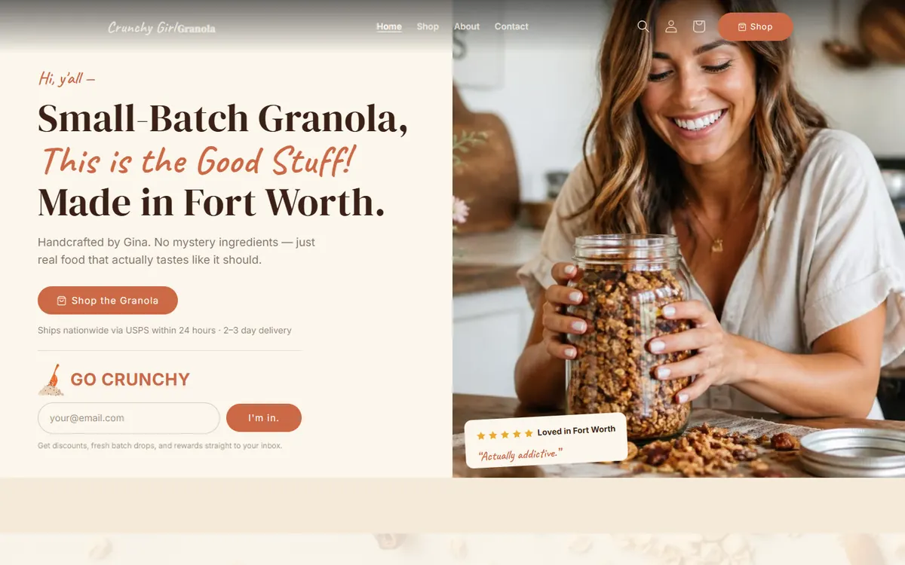

# Crunchy Girl Granola — custom theme + admin tooling

A Shopify theme restyled from a Lovable prototype, plus a private admin app for products and Seal subscriptions.

**Live site:** https://www.crunchygirlgranola.com  
**Portfolio:** https://izainpasha.github.io

## The problem
Turn a Lovable prototype into a real store, and give the team a safe way to manage products and Seal subscriptions.

## What I built
`theme/`: Online Store 2.0 theme on Dawn with custom homepage sections. `admin-app/`: a private Node CLI and Shopify app using Admin GraphQL and the Seal Subscriptions API. Write commands need explicit confirmation, and secrets are entered through a secure prompt, never stored in code.

## Result
Cart, checkout, search and variants work out of the box; the admin tooling cannot write without `--confirm`.

## Stack
Liquid · Dawn · Node.js · Admin GraphQL · Seal API · Preact

---

Built by [Syed Zain Pasha](https://izainpasha.github.io) — full-stack and Shopify developer. Client data, credentials and environment files are not included.
